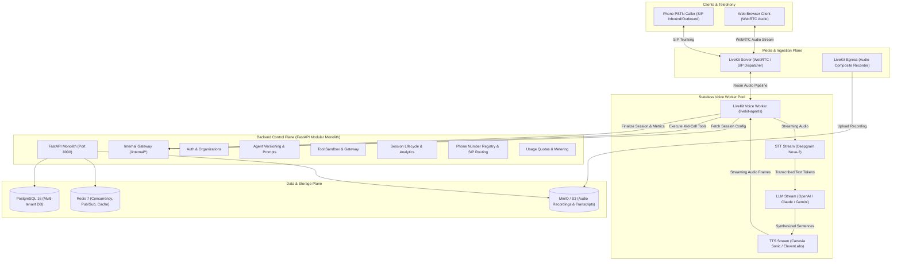
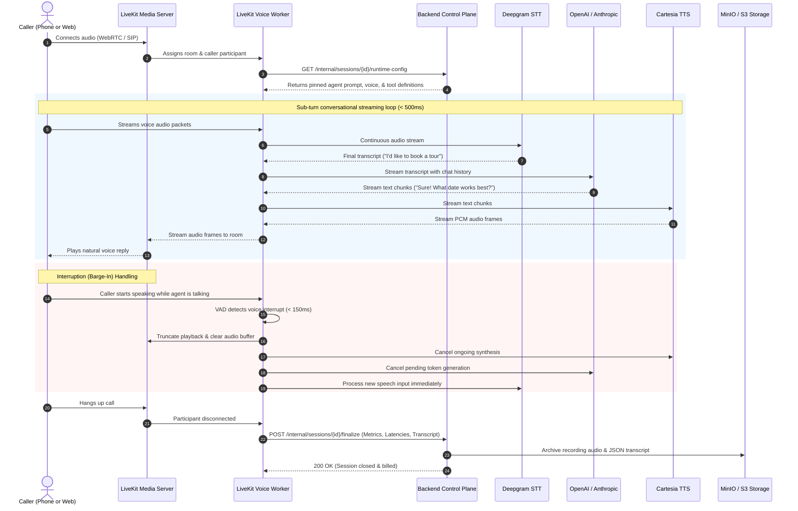
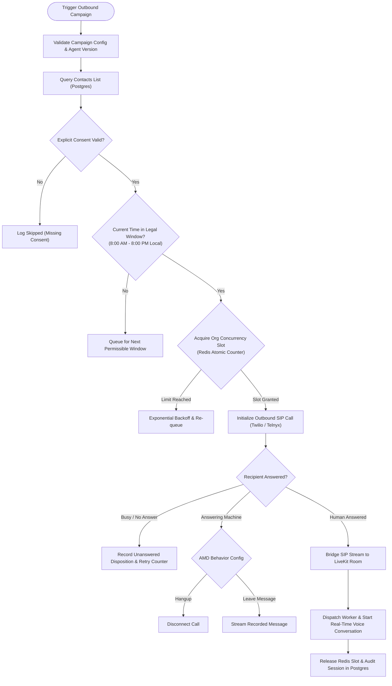
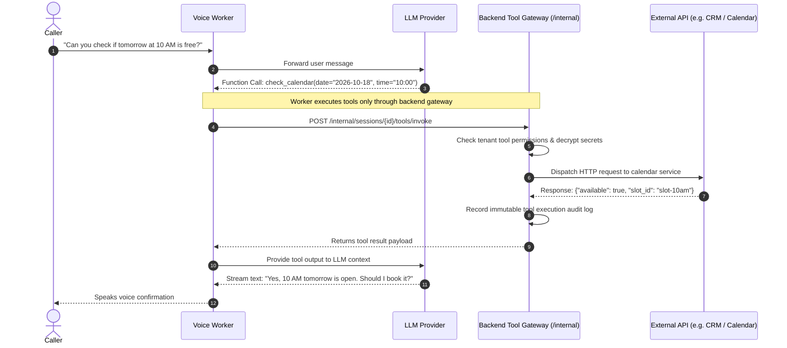
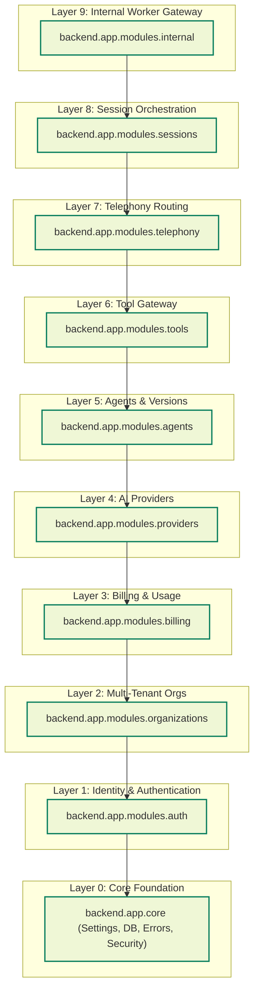

# Cadence 🎙️⚡

> **Multi-Tenant Real-Time AI Voice Agent Platform**  
> Sub-500ms voice agents that listen, reply in real time, handle caller interruptions gracefully, and execute actions mid-call across browser WebRTC and PSTN telephony.

[](LICENSE)
[](https://www.python.org/)
[](https://fastapi.tiangolo.com/)
[](https://nextjs.org/)
[](https://livekit.io/)
[](https://tailwindcss.com/)

---

## Table of Contents

- [Overview](#overview)
- [System Architecture](#system-architecture)
- [Voice Pipelines & Flow Diagrams](#voice-pipelines--flow-diagrams)
  - [1. Inbound Call & Voice Pipeline Sequence](#1-inbound-call--voice-pipeline-sequence)
  - [2. Outbound Campaign Dispatch Pipeline](#2-outbound-campaign-dispatch-pipeline)
  - [3. Mid-Call Tool Execution Pipeline](#3-mid-call-tool-execution-pipeline)
  - [4. Backend Modular Monolith Layer Contract](#4-backend-modular-monolith-layer-contract)
- [Key Features](#key-features)
- [Repository Structure](#repository-structure)
- [Getting Started](#getting-started)
  - [Prerequisites](#prerequisites)
  - [1. Environment Setup](#1-environment-setup)
  - [2. Local Infrastructure](#2-local-infrastructure)
  - [3. Backend API](#3-backend-api)
  - [4. Frontend Web Application](#4-frontend-web-application)
  - [5. Voice Agent Worker](#5-voice-agent-worker)
- [Quality Verification & Testing](#quality-verification--testing)
- [Architecture & Design System](#architecture--design-system)

---

## Overview

Cadence is a developer-friendly, multi-tenant platform for building, testing, deploying, and monitoring autonomous voice agents. 

Unlike traditional interactive voice response (IVR) phone menus, Cadence agents operate on high-speed streaming pipelines connecting **streaming speech-to-text (STT)**, **large language models (LLMs)**, and **streaming text-to-speech (TTS)**. Callers can interrupt mid-sentence without acoustic echo, while the agent tracks conversation history, queries internal knowledge, calls backend tools, or transfers callers when needed.

---

## System Architecture

The monorepo is organized into three decoupled runtimes:
1. **Frontend (`frontend/`)**: Next.js App Router with Tailwind CSS, Aceternity UI, and shadcn/ui components.
2. **Backend (`backend/`)**: FastAPI modular monolith with strict domain layering enforced by `import-linter`.
3. **Voice Worker (`worker/`)**: Stateless Python worker powered by `livekit-agents` and WebRTC/SIP media pipelines.



---

## Voice Pipelines & Flow Diagrams

### 1. Inbound Call & Voice Pipeline Sequence

This sequence highlights the sub-turn streaming loop, barge-in detection (caller interruptions), and session audit logging.



---

### 2. Outbound Campaign Dispatch Pipeline

Automated campaign dialing with strict consent verification, legal time-window controls, and concurrency limiting.



---

### 3. Mid-Call Tool Execution Pipeline

When the agent requires external data (checking calendar, querying an order, transfer), execution is safely routed through the backend tool gateway.



---

### 4. Backend Modular Monolith Layer Contract

To maintain modularity and avoid tight coupling, all backend modules adhere to a unidirectional dependency hierarchy strictly enforced by `import-linter`.



> [!IMPORTANT]
> A module may **only** import from another module through its public `__init__.py` interface. Cross-importing private models or repositories is automatically blocked by `lint-imports` in CI.

---

## Key Features

- **Ultra-Low Latency Pipeline**: Streaming STT + streaming LLM tokens + streaming TTS chunks deliver sub-500ms voice response latency.
- **Barge-In Interruption Handling**: Immediate speech playback truncation upon caller vocalization with acoustic echo suppression.
- **Two Doors, One Agent**: Pinned agent configuration can answer both high-fidelity browser WebRTC sessions and PSTN phone calls via SIP trunking.
- **Dynamic Mid-Call Tool Execution**: Safe tool invocation gateway with audit logging and secret isolation.
- **Immutable Agent Versioning**: Each prompt, provider, or voice tweak creates an immutable revision. Live conversations remain locked to their starting version.
- **Multi-Tenant Isolation**: Every database record, recording, and usage metric is strictly partitioned by `organization_id`.
- **Modern UI**: Polished marketing landing page and dashboard shell powered by Next.js 15, Tailwind CSS, Aceternity UI effects (`BackgroundBeams`, `CardSpotlight`, `BentoGrid`, `TextGenerateEffect`), and shadcn primitives.

---

## Repository Structure

```
├── .github/
│   └── workflows/ci.yml       # GitHub Actions verification workflow
├── backend/
│   ├── app/
│   │   ├── core/              # Settings, DB session, Security, Errors
│   │   ├── modules/           # Domain modules (auth, orgs, agents, tools, etc.)
│   │   └── main.py            # FastAPI application entrypoint
│   └── tests/                 # Health, module, and boundary test suite
├── worker/
│   ├── agent/                 # LiveKit worker entrypoint and runtime fetcher
│   ├── providers/             # Abstract interfaces (STT, LLM, TTS)
│   └── tests/                 # Worker interface and dispatch smoke tests
├── frontend/
│   ├── src/
│   │   ├── app/               # Next.js App Router ((marketing) and (app)/dashboard)
│   │   ├── components/        # Aceternity UI, shadcn components & marketing sections
│   │   └── lib/               # Design tokens and utilities
│   └── tests/                 # Vitest test suite for tokens, shell & landing page
├── deploy/
│   ├── docker-compose.yml     # Local stack: Postgres, Redis, MinIO, LiveKit
│   └── livekit.yaml           # Development LiveKit server configuration
├── docs/                      # Architectural specs, milestone plans, and ADRs
├── scripts/
│   └── verify_all.sh          # Global 7-step quality verification runner
└── pyproject.toml             # Python tools config (Ruff, Mypy, Pytest)
```

---

## Getting Started

### Prerequisites

- **Python**: `3.11+` with [`uv`](https://github.com/astral-sh/uv)
- **Node.js**: `20+` with [`pnpm`](https://pnpm.io/)
- **Docker**: Docker Desktop (v24.0+ with Docker Compose v2.20+)

---

### 1. Environment Setup

Create local environment configuration files from the templates:

```bash
# Root project environment
cp .env.example .env

# Docker compose infrastructure environment
cp deploy/env.example deploy/.env
```

---

### 2. Local Infrastructure

Start the local backing services (PostgreSQL, Redis, MinIO, and LiveKit):

```bash
docker compose -f deploy/docker-compose.yml up -d
```

Verify service health:

```bash
docker compose -f deploy/docker-compose.yml ps
```

| Service | Port | Default Credentials |
| :--- | :--- | :--- |
| **PostgreSQL 16** | `5432` | User: `cadence`, Password: `cadence_password`, DB: `cadence_dev` |
| **Redis 7** | `6379` | None |
| **MinIO API / Console** | `9000` / `9001` | User: `minioadmin`, Password: `minioadmin_secret` |
| **LiveKit Server** | `7880` (HTTP/WS) | Key: `devkey`, Secret: `secret` |

---

### 3. Backend API

Run the FastAPI control plane:

```bash
uv run --with uvicorn uvicorn backend.app.main:app --host 127.0.0.1 --port 8000 --reload
```

- **Health check**: [http://127.0.0.1:8000/health/live](http://127.0.0.1:8000/health/live)
- **Readiness probe**: [http://127.0.0.1:8000/health/ready](http://127.0.0.1:8000/health/ready)
- **Interactive OpenAPI Documentation**: [http://127.0.0.1:8000/docs](http://127.0.0.1:8000/docs)

---

### 4. Frontend Web Application

Start the Next.js development server:

```bash
cd frontend
pnpm dev
```

- **Marketing Landing Page**: [http://localhost:3000](http://localhost:3000)
- **Dashboard App Shell**: [http://localhost:3000/dashboard](http://localhost:3000/dashboard)

---

### 5. Voice Agent Worker

Start the LiveKit agent worker in development mode:

```bash
uv run python -m worker.agent.entrypoint dev
```

---

## Quality Verification & Testing

Cadence enforces strict quality gates across linting, type safety, test suites, and boundary isolation.

To run the entire suite in one command:

```bash
./scripts/verify_all.sh
```

Or run individual verification commands:

```bash
# 1. Backend Linting & Formatting
uv run ruff check . && uv run ruff format --check .

# 2. Strict Type Checking (Python)
uv run mypy backend worker

# 3. Backend Unit & Health Tests
uv run pytest -q

# 4. Architectural Boundary Enforcement
uv run lint-imports

# 5. Frontend Linting
cd frontend && pnpm lint

# 6. Frontend Strict TypeScript Check
cd frontend && pnpm typecheck

# 7. Frontend Vitest Suite
cd frontend && pnpm test
```

---

## Architecture & Design System

- **Technical Architecture**: See [docs/ARCHITECTURE.md](docs/ARCHITECTURE.md) for data schemas, security checklists, and deployment topologies.
- **Roadmap & Milestones**: See [docs/PLAN.md](docs/PLAN.md) for Milestone M0 through M8 acceptance criteria.
- **Architectural Decisions (ADRs)**: See [docs/DECISIONS.md](docs/DECISIONS.md) for rationale behind core technology choices.
- **Reverse Engineering Analysis**: See [intent/reverse-engineering-report.md](intent/reverse-engineering-report.md) for technical teardown and benchmarking.
