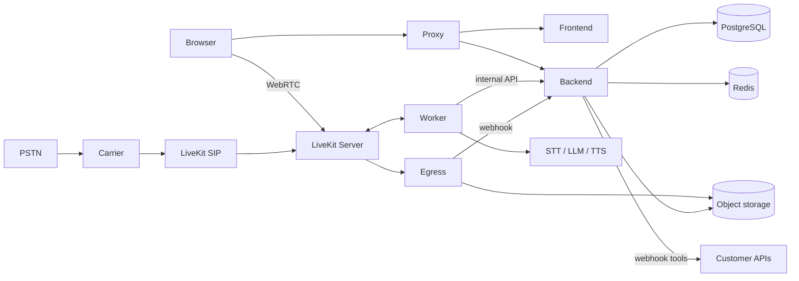
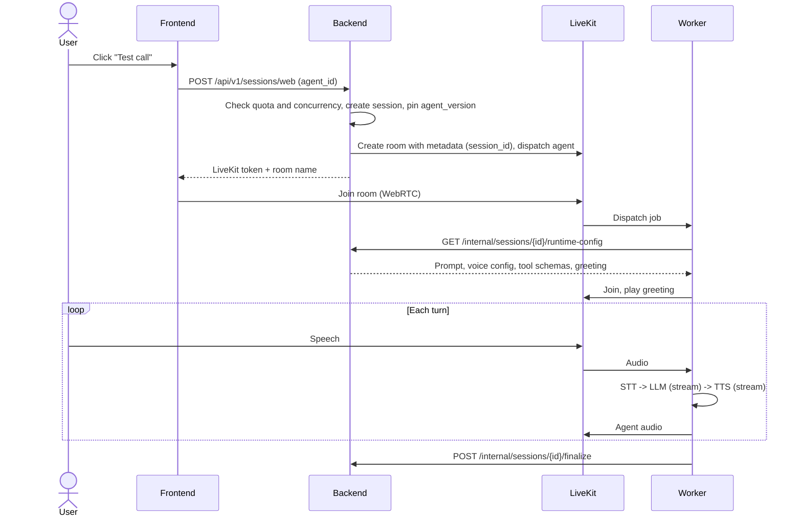

# Cadence Architecture (MVP)

Scope: the MVP defined in `docs/PLAN.md`. Intent and non-goals are in `intent.md`.
Anything marked **Post-MVP** is intentionally absent from the first build.
Library and model versions must be verified against current docs at build time.

## 1. System overview

Cadence has three deployables plus infrastructure:

| Deployable | Tech | Responsibility |
|---|---|---|
| `backend` | FastAPI, Pydantic v2 | Control plane. Owns all state, config, auth, billing and tool execution |
| `worker` | Python, `livekit-agents` | Runs one voice conversation per room. Stateless |
| `frontend` | Next.js App Router, Tailwind, SWR | Dashboard and browser test-call UI |

| Infrastructure | Use |
|---|---|
| PostgreSQL | All relational data |
| Redis | Concurrency counters, rate limits, pub/sub for live events |
| S3-compatible storage (MinIO locally) | Call recordings |
| LiveKit server, SIP, Egress | Rooms, telephony bridge, recording |
| Reverse proxy (Nginx or Caddy) | TLS and routing to frontend and backend |



### Core design rules

1. **The worker is thin.** It holds no database access and no business rules. It asks the backend for config, executes the conversation, and reports results.
2. **The backend is the only writer of state.** Tools, usage and logs all pass through it.
3. **Config is pinned per session.** A session records the exact `agent_version_id` it started with, so editing an agent never changes a live call.
4. **Vendors sit behind interfaces.** No business logic imports a vendor SDK.
5. **Every row that belongs to a tenant carries `organization_id`**, and every query filters on it.

## 2. Repository layout

```
/
├── AGENTS.md
├── intent.md
├── docs/            PLAN.md, ARCHITECTURE.md, DECISIONS.md
├── backend/
│   ├── app/
│   │   ├── main.py
│   │   ├── core/            settings, db, security, errors, logging, deps
│   │   ├── modules/
│   │   │   ├── auth/
│   │   │   ├── organizations/
│   │   │   ├── agents/
│   │   │   ├── providers/      catalog + provider interfaces
│   │   │   ├── tools/
│   │   │   ├── telephony/
│   │   │   ├── sessions/       sessions, transcripts, recordings, metrics
│   │   │   ├── billing/        plans, usage, quotas, Stripe
│   │   │   └── internal/       worker and webhook endpoints
│   │   └── migrations/
│   └── tests/
├── worker/
│   ├── agent/           entrypoint, pipeline builder, tool bridge
│   ├── providers/       STT/LLM/TTS adapters
│   └── tests/
├── frontend/
│   └── src/{app/(marketing),app/(app),features,components/ui,components/marketing,lib}
└── deploy/              docker-compose, proxy config, env examples
```

## 3. Backend modules

Each module contains `router.py` (HTTP only), `service.py` (logic), `repository.py` (DB), `schemas.py`, and an `__init__.py` that defines the **only** public interface other modules may import.

| Module | Owns |
|---|---|
| `auth` | Login, refresh, password reset, JWT, CSRF |
| `organizations` | Organizations, memberships, roles, invites |
| `agents` | Agents, immutable versions, greeting and silence settings |
| `providers` | Static model/voice catalog, provider interfaces, credential lookup |
| `tools` | Tool definitions (`http`, `transfer`), execution, audit log |
| `telephony` | Phone numbers, SIP trunk config, number-to-agent routing |
| `sessions` | Session lifecycle, transcripts, recordings, metrics |
| `billing` | Plans, subscriptions, usage events, quota checks, Stripe |
| `internal` | Worker-facing and webhook endpoints. Calls other modules' public interfaces only |

Dependency direction: `internal` and routers depend on services. Services depend on repositories and other modules' public interfaces. Never the reverse. Enforce with `import-linter`.

## 4. Data model (core tables)

All tables have `id` (UUID), `created_at`, `updated_at`. Tenant-owned tables have `organization_id` (indexed, non-null).

| Table | Key fields |
|---|---|
| `organizations` | name, plan_id, stripe_customer_id |
| `users` | email (unique), password_hash, is_active |
| `memberships` | user_id, organization_id, role (`owner`, `admin`, `member`) |
| `refresh_tokens` | user_id, token_hash, expires_at, revoked_at |
| `agents` | organization_id, name, current_version_id |
| `agent_versions` | agent_id, version_no, system_prompt, greeting, stt/llm/tts config (JSON), silence_timeout_s, created_by. **Immutable** |
| `tools` | organization_id, name, type, config (JSON, includes optional `outcome_label`), json_schema |
| `agent_tools` | agent_version_id, tool_id |
| `phone_numbers` | organization_id, e164, carrier, agent_id, trunk_ref |
| `sessions` | organization_id, agent_id, agent_version_id, channel (`web`, `phone`), status, outcome (`completed`, `transferred`, `failed`, `abandoned`), outcome_label (optional text), room_name, started_at, ended_at, duration_s, recording_key |
| `transcript_segments` | session_id, seq, speaker (`caller`, `agent`), text, started_at_ms |
| `session_metrics` | session_id, avg/p95 latency per stage, interruption count |
| `tool_calls` | session_id, tool_id, arguments, result, status, latency_ms |
| `plans` | code, limits (agents, concurrency, minutes) |
| `usage_events` | organization_id, session_id, seconds, recorded_at |

Rules:
- Use soft status fields for sessions. Never hard-delete sessions or usage events.
- Secrets (webhook auth headers, provider keys) are encrypted at rest with an app-level key. Never return them from the API.
- Migrations are forward-only and reviewed. Destructive migrations need approval.

## 5. Auth and tenancy

- Access token: short-lived JWT carrying `user_id`, `organization_id`, `role`.
- Refresh token: opaque, stored hashed, rotated on use, revocable.
- If cookies are used for refresh, enforce CSRF protection. Bearer API keys are **Post-MVP**.
- Every service method takes an explicit `organization_id` from the authenticated context. Repositories refuse to run tenant queries without it.
- Roles: `owner` (billing, delete org), `admin` (manage agents, members), `member` (use and view).
- Required test for every endpoint: a user in organization A cannot read or modify organization B's data.
- Internal endpoints use a separate service token (`X-Internal-Service-Token`), compared in constant time, and are not exposed through the public proxy route.

## 6. Key flows

### 6.1 Browser test call



**Live transcript:** during the call the worker publishes caller and agent text, and tool-call events, to the room (LiveKit transcription or data channel). The browser renders them in the test call panel. This is display only. The stored transcript written at finalize is the source of truth.

Design choice: the worker fetches config by **session id**, not agent id. This makes the pinned version unambiguous.

### 6.2 Inbound phone call

1. Carrier sends a SIP INVITE to LiveKit SIP.
2. A SIP dispatch rule maps the dialed number to a room and sets room metadata.
3. The backend is told of the call through the SIP intake endpoint (`POST /internal/sessions/intake`). It resolves number to agent, checks quota and concurrency, creates the session, and returns the session id. If rejected, the call is ended with a spoken message or a SIP rejection.
4. From here the flow matches 6.1.

### 6.3 Tool invocation

1. The LLM emits a tool call. The worker forwards it: `POST /internal/sessions/{id}/tools/invoke {tool_name, arguments}`.
2. The backend validates the tool belongs to the session's pinned version, validates arguments against the JSON schema, and executes it:
   - `http`: outbound request with timeout, size limits and an SSRF guard (block private and loopback ranges, restrict redirects).
   - `transfer`: initiate a SIP transfer to a configured number (mock in tests).
3. The backend writes a `tool_calls` row and returns the result (truncated to a safe size) to the worker.
4. The worker feeds the result back to the LLM. Tool timeout is short (default 8 s). On timeout the LLM receives a clear error and the agent recovers verbally.

### 6.4 Session finalization and recording

- The worker posts final transcript and metrics on call end. It must also do so on error paths.
- LiveKit Egress writes audio to object storage and calls a signed webhook. The backend stores `recording_key` on the session.
- A reconciliation job closes sessions with no heartbeat for N minutes as `failed`, and records the duration actually used.
- Usage events are created from finalized sessions (rounded up per policy in `DECISIONS.md`).
- Recording playback goes through a backend endpoint that checks organization ownership and returns a short-lived signed URL or streams bytes.

## 7. Voice pipeline (MVP)

**One mode only: `classic` (STT -> LLM -> TTS).** Native speech-to-speech modes are Post-MVP, but the pipeline builder takes a `pipeline_mode` field so they can be added without schema changes.

Provider interfaces (worker side): `STTProvider`, `LLMProvider`, `TTSProvider`, each with a factory keyed by config. The MVP ships one adapter per type. Defaults are chosen in `docs/DECISIONS.md` after checking current offerings.

Required behaviors:
- Streaming at every stage (no waiting for full responses).
- Voice activity detection and turn detection tuned and tested.
- Barge-in: when the caller speaks over the agent, stop TTS immediately and cancel the in-flight LLM response.
- Silence handling: configurable timeout, one gentle prompt, then end the call.
- Hard limits: maximum call duration and maximum tool calls per session.

**Latency budget** (target, to be measured in M3 and tracked after): caller stops speaking to first agent audio should feel instant. Record per-stage timings (STT final, LLM first token, TTS first byte) for every turn in `session_metrics`.

## 8. Telephony (MVP)

- One carrier integration, chosen in `DECISIONS.md`. The carrier code sits behind a `TelephonyProvider` interface.
- Inbound only. Outbound calling and campaigns are Post-MVP.
- Number purchase and trunk provisioning start as documented manual setup plus a config endpoint. Automated provisioning is Post-MVP.
- Each number maps to exactly one agent.

## 9. Billing and quotas (MVP)

- `plans` table seeded with a free tier and paid tiers. Limits: agents, concurrent calls, monthly minutes.
- Concurrency enforced with a Redis counter incremented at session start and decremented on finalize (with TTL as a safety net).
- Minutes enforced from `usage_events` aggregated for the billing period.
- Stripe: Checkout for upgrading and Billing Portal for managing. Webhook updates the organization's plan. Handle webhook idempotency and signature verification.
- Overage billing is Post-MVP. At the limit, new calls are refused.

## 10. API conventions

- Prefix `/api/v1`. Internal endpoints under `/internal`, excluded from the public proxy.
- JSON errors with a stable shape: `{ "error": { "code", "message", "details" } }`.
- Pagination: cursor-based on list endpoints.
- Idempotency keys on endpoints that create billable or external side effects.
- OpenAPI is generated and committed. The frontend client is generated from it, not hand-written.

## 11. Frontend

Feature folders: `auth`, `agents`, `calls` (test call and history), `numbers`, `tools`, `billing`, `settings`. Shared UI in `components/ui`, shared helpers in `lib/`.

- Server state with SWR. No global store unless justified.
- Test-call UI uses LiveKit's React components for audio and connection state, and renders the live transcript and tool-call lines from room events.
- Visual tokens live in `frontend/src/lib/tokens` as CSS variables and are the single source for both the app and the marketing site. They follow the brand direction in `docs/PLAN.md`: pure white light theme, neutral near-black dark theme, one small green accent for live and success states, Bricolage Grotesque for headings and Hanken Grotesk for body text. Themes follow the system setting with a manual toggle.
- Whitespace is part of the design system. Spacing tokens encode the generous scale from the design reference (large section gaps, roomy card padding). Do not tighten them to fit more content.
- UI primitives come from shadcn/ui. Framer Motion handles animation. Aceternity-style effects (Spotlight, Bento Grid, Moving Border, Text Generate Effect) are copied into `components/marketing` and owned by the repo. Dashboard screens use motion only to show state changes.
- **Marketing site:** the `(marketing)` route group is statically generated, has its own layout, and calls no backend or auth code. The authenticated product lives in `(app)`. Only the marketing site uses decorative motion, and it must respect `prefers-reduced-motion`.
- Marketing copy may only claim features that are shipped. Unshipped features carry a "Coming soon" label (rule enforced by the copy review in `docs/PLAN.md`, milestone MS).
- Dashboard stat tiles read from `GET /api/v1/stats/overview` (calls today, median response time, tool calls, live calls against the limit), tenant-scoped.
- Call detail page: transcript, tool calls, metrics, audio player.

## 12. Observability and operations

- Structured JSON logs with `request_id`, `organization_id` and `session_id`. No PII above debug level.
- Health: `/health/live` (process only) and `/health/ready` (dependencies). Liveness must not depend on the database.
- Metrics: call counts, active calls, per-stage latency, tool failures, provider errors.
- Error tracking (Sentry or equivalent) on all three deployables.
- Local development and early staging: Docker Compose. Production deployment details go in `DECISIONS.md` when decided.
- Backups for PostgreSQL and the recordings bucket are a launch requirement.

## 13. Security checklist

- Password hashing with a modern algorithm (argon2 or bcrypt).
- Rate limiting on login, password reset, token issuance and tool invocation.
- SSRF guard on all outbound customer-configured URLs.
- LiveKit tokens are short-lived and scoped to a single room.
- Webhooks (LiveKit, Stripe) verify signatures.
- Secrets only from environment or a secret manager. `.env.example` has placeholders only.
- Recording consent notice configurable per agent. Retention policy configurable per organization (default in `DECISIONS.md`).
- Dependency scanning in CI.

## 14. Testing strategy

| Level | What |
|---|---|
| Unit | Services, schema validation, provider adapters with fakes |
| Integration | API with a real PostgreSQL and Redis, including tenant isolation tests |
| Contract | Worker against the internal API using recorded fixtures |
| Voice | Scripted audio through the pipeline with fake providers; barge-in and silence tests |
| E2E | One browser test call with fake providers in CI; one real-provider smoke test run manually |

Real calls and real provider spend never happen in CI.

## 15. Post-MVP (explicitly not designed here)

Knowledge base and RAG, outbound campaigns, MCP tools, bring-your-own provider keys, API-key access, native speech-to-speech pipelines, automated number provisioning, overage billing, multi-region.
