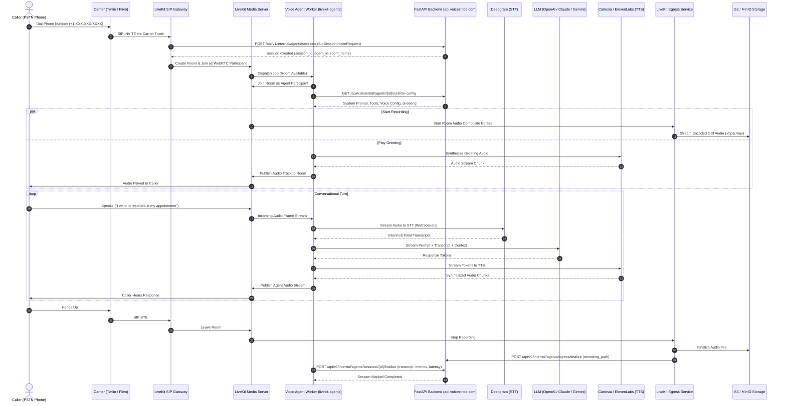
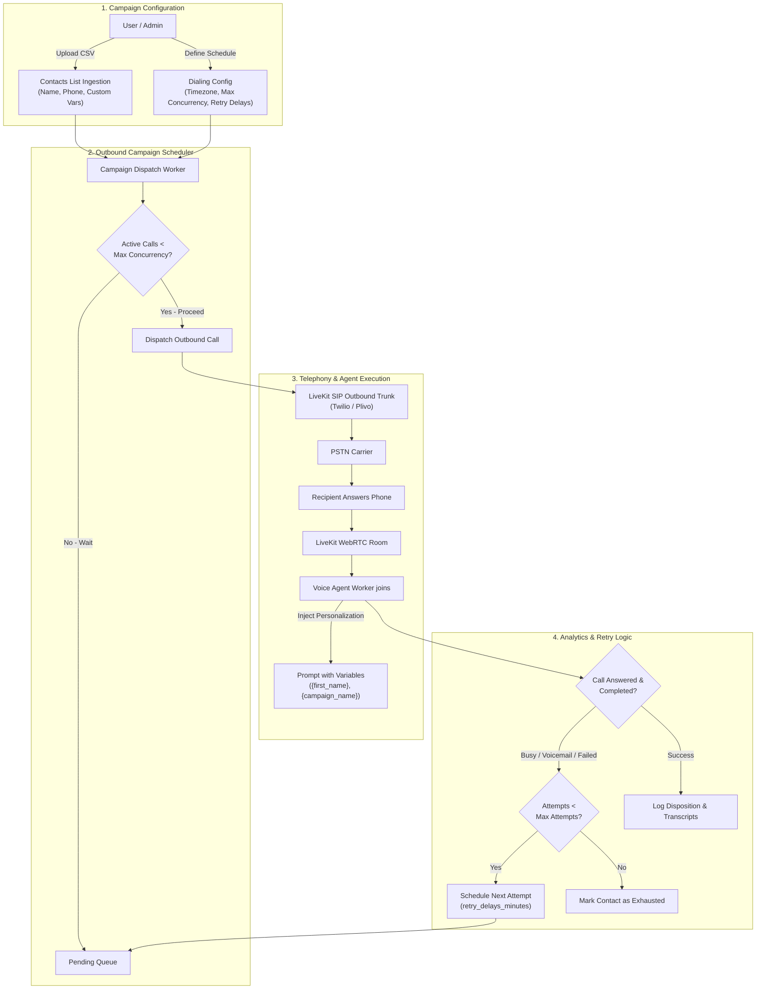
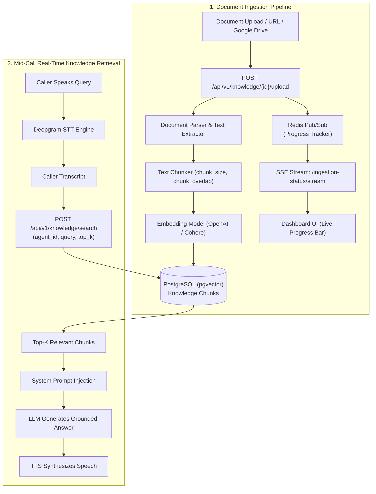
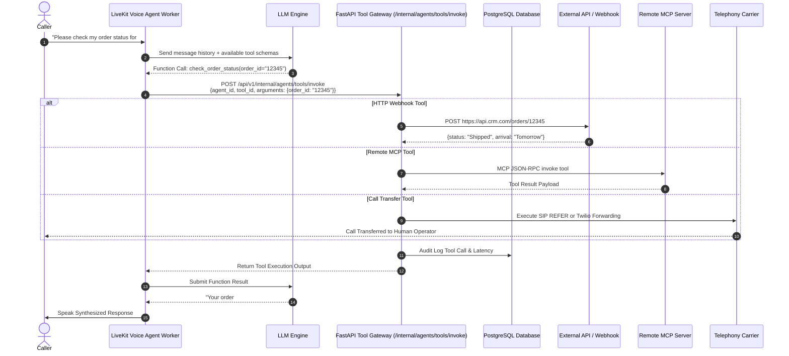

# VoiceStride (https://voicestride.com) — Full Architectural & Reverse-Engineering Report

This report provides an in-depth technical reverse-engineering analysis of **VoiceStride** (`https://voicestride.com`), compiled through active reconnaissance, DNS analysis, HTTP header inspection, client-side bundle disassembly (Next.js/Turbopack), and complete inspection of their live production backend OpenAPI specification (`https://api.voicestride.com/openapi.json`) and Swagger documentation.

---

## 1. Executive Summary

VoiceStride is an enterprise-grade AI Voice Agent platform designed for autonomous inbound customer support, outbound dialing campaigns, and business workflow automation. 

Architecturally, VoiceStride is structured as a **Modular Monolith**:
- A decoupled **Next.js 16 (React 19)** frontend hosted behind **Nginx**.
- A central **Python FastAPI** control plane exposing 212 REST API endpoints.
- A **PostgreSQL** relational database with **Redis** for pub/sub, caching, and Server-Sent Events (SSE).
- An **S3 / MinIO** object storage layer for audio recordings and uploaded knowledge base documents.
- A real-time voice infrastructure powered by **LiveKit WebRTC**, **LiveKit SIP Trunking**, **LiveKit Egress**, and a cluster of autonomous Python **`livekit-agents`** voice workers.

---

## 2. High-Level Architecture & Technical Diagrams

### A. High-Level Multi-Tier System Architecture
```mermaid
flowchart TD
    subgraph Clients["Clients & Ingress"]
        Browser["Web Dashboard & Calling Widget<br/>(LiveKit WebRTC Client)"]
        PSTN["PSTN Phone Callers<br/>(Twilio / Plivo / Telnyx / Wavix)"]
        ExtAPI["External API / CRM Integrations<br/>(Bearer API Keys)"]
    end

    subgraph EdgeProxy["Reverse Proxy & Edge"]
        Nginx["Nginx 1.24.0 (Ubuntu Linux)<br/>Contabo Cloud VPS (Lauterbourg, France)"]
    end

    subgraph Frontend["Frontend Tier"]
        NextServer["Next.js 16.1.6 App Router<br/>React 19.3.0 (Canary) + Turbopack<br/>Tailwind CSS + SWR + Framer Motion"]
    end

    subgraph BackendMonolith["FastAPI Modular Monolith API"]
        FastAPI["FastAPI 1.0.0 (Python 3.11/3.12)<br/>212 REST Endpoints / 204 Pydantic Schemas"]
        AuthModule["Auth & RBAC (JWT, CSRF, Orgs)"]
        AgentModule["Agent & Model Configuration"]
        TelephonyModule["Telephony & Trunking Manager"]
        CampaignModule["Outbound Campaign Scheduler"]
        KnowledgeModule["RAG Knowledge Subsystem"]
        BillingModule["Stripe Billing & Quotas"]
        InternalModule["Internal Worker Gateway (X-Internal-Service-Token)"]
    end

    subgraph StorageLayer["Data & Persistence Tier"]
        Postgres[("PostgreSQL Multi-tenant Database")]
        RedisStore[("Redis (Pub/Sub, SSE Stream, Caching)")]
        S3Storage[("AWS S3 / MinIO (Call Audio & Uploaded Docs)")]
    end

    subgraph VoiceCluster["LiveKit Realtime Voice Cluster"]
        LK_Server["LiveKit Media Server (WebRTC Rooms)"]
        LK_SIP["LiveKit SIP Trunking Gateway"]
        LK_Egress["LiveKit Egress Service (Audio Recording)"]
        LK_Worker["LiveKit Python Voice Agent Worker<br/>(livekit-agents)"]
    end

    subgraph AIProviders["Speech & Model Providers"]
        STT["STT: Deepgram (Nova-2), Whisper"]
        LLM["LLMs: OpenAI GPT-4o, Claude 3.5, Gemini, Groq, Together"]
        TTS["TTS: Cartesia Sonic, ElevenLabs Turbo v2.5"]
        NativeVoice["Multimodal: OpenAI Realtime / Gemini Live"]
        MCPServers["Remote MCP Servers (Model Context Protocol)"]
    end

    Browser -->|HTTPS| Nginx
    ExtAPI -->|REST API| Nginx
    Nginx -->|Proxy :3000| NextServer
    Nginx -->|Proxy :8000| FastAPI

    FastAPI --> AuthModule & AgentModule & TelephonyModule & CampaignModule & KnowledgeModule & BillingModule & InternalModule
    AuthModule & AgentModule & TelephonyModule & CampaignModule & KnowledgeModule & BillingModule --> Postgres
    KnowledgeModule --> RedisStore
    InternalModule --> S3Storage

    Browser -->|WebRTC Audio| LK_Server
    PSTN -->|SIP Inbound/Outbound| LK_SIP
    LK_SIP --> LK_Server
    LK_Server <-->|Audio Stream| LK_Worker

    LK_Worker -->|GET runtime-config & POST tools/invoke| InternalModule
    LK_Worker --> STT & LLM & TTS & NativeVoice
    InternalModule --> MCPServers
    LK_Egress -->|Save Audio (MP3/WAV)| S3Storage
    LK_Egress -->|Finalize Egress Webhook| InternalModule
```

### B. Real-Time Inbound Voice Call Flow & Media Pipeline


### C. Outbound Campaign Dialing Architecture & Workflow


### D. RAG Knowledge Base Ingestion & Real-Time Retrieval Pipeline


### E. Tool Execution & Model Context Protocol (MCP) Flow


---

## 3. Web Frontend Architecture

- **Framework**: **Next.js 16.1.6** using the **App Router** (`appDir: true`, confirmed directly via client bundle runtime: `window.next = { version: "16.1.6", appDir: true }`).
- **React Runtime**: **React 19.3.0-canary** (React 19 Server Components and streaming architecture).
- **Bundler**: **Turbopack** (confirmed via runtime module loader `turbopack-7d047d326522dcfd.js` and Turbopack chunking conventions).
- **Styling**: **Tailwind CSS** with over 3,500 custom CSS variables (e.g., `--tw-translate-x`, `--tw-rotate-x`, dark theme tokens `bg-[#06070d]`, `selection:bg-purple-500`).
- **Typography & Web Fonts**:
  - `DM Sans` (Google Fonts preconnect)
  - Preloaded local fonts: `Reckless Standard S` (Editorial serif) and `Inter` (Regular & SemiBold).
- **Icons & Animation**:
  - `lucide-react` for UI icons.
  - `framer-motion` for transitions, drawers, and modal animations.
- **Client State & Data Fetching**:
  - **SWR** (`swr`) for client-side optimistic cache invalidation and data synchronization.
- **Auth Client & Session Management**:
  - Custom in-house auth client layer (`AuthProvider`, `useAuth`, `getAuthSessionState`, `[authClientTransport]`).
  - Handles JWT access tokens, silent refresh (`/api/v1/auth/refresh`), token rotation, and CSRF protection (`X-CSRF-Token`, `NEXT_PUBLIC_AUTH_CSRF_HEADER_NAME`, `NEXT_PUBLIC_AUTH_CSRF_COOKIE_NAME`).
  - Standard route guards redirect unauthenticated users (`/auth/login?callbackUrl=%2Fdashboard`).
- **Real-Time UI Streams**:
  - **Server-Sent Events (SSE)** via `/api/v1/knowledge/{kb_id}/ingestion-status/stream` powered by backend Redis Pub/Sub for live document indexing and status updates.

---

## 4. Backend & Infrastructure Details

### A. Hosting & Infrastructure
- **Server Provider**: **Contabo Cloud VPS** (`vmi3129408.contaboserver.net`, IP `207.180.208.105` in Lauterbourg, Grand Est, France).
- **Web Server / Reverse Proxy**: **Nginx 1.24.0 (Ubuntu)** handling SSL termination, HTTP/1.1 keep-alives, security headers (`Strict-Transport-Security`, `X-Content-Type-Options: nosniff`), and reverse proxying to Next.js and FastAPI.
- **DNS**: InMotion Hosting nameservers (`ns1.inmotionhosting.com`, `ns2.inmotionhosting.com`).
- **SSL Certificates**: Let's Encrypt certificates covering `voicestride.com`, `www.voicestride.com`, and `api.voicestride.com`.

### B. Backend API Framework
- **Framework**: **FastAPI** (Python 3.11/3.12) with **Pydantic v2** validation.
- **Architecture**: Self-proclaimed **Modular Monolith API** (v1.0.0).
- **API Surface**: **212 API endpoints** and **204 schemas**.

### C. Backend Modular Services
1. **`auth` & `organizations`**: Multi-tenant organization scoping, role-based access control (`org_admin`, `super_admin`, `member`), member invites, and password resets.
2. **`agents`**: Agent creation, prompt engineering, version history, prompt diff chunking, greeting settings, and silence timeouts.
3. **`models` & `providers`**: Dynamic model catalog, BYOK (Bring Your Own Key) provider credentials vault.
4. **`telephony`**: LiveKit SIP trunk provisioning, number inventory management, and routing for Twilio, Plivo, Telnyx, and Wavix.
5. **`campaigns`**: Outbound calling campaign manager with timezone-aware scheduling, retry strategies, and contact list uploads.
6. **`knowledge`**: Document ingestion, URL scraping, Google Drive sync, chunking (`chunk_size`, `chunk_overlap`, `top_k`), and vector search.
7. **`mcp-servers`**: Model Context Protocol client allowing agents to register, verify, and call tools from remote MCP servers.
8. **`tools`**: HTTP webhooks, human call transfers, and built-in system tools.
9. **`sessions` & `logs`**: WebRTC room logging, turn-by-turn latency summaries, audio recording streams, and tool call audit logs.
10. **`internal`**: Protected endpoints accessed by the voice agent workers via `X-Internal-Service-Token`.

### D. Data & Persistence Layer
- **PostgreSQL**:
  - Relational database storing tenants, users, agents, campaigns, and sessions.
  - Verified by developer comments in `/health/ready` and model schemas:
    > *"Liveness check that needs the database would have the orchestrator restart healthy processes during a Postgres blip. Dependency health lives on /health/ready."*
  - Data isolation: Tenant isolation enforced via queries joining to `VoiceAgent.organization_id`.
- **Redis**:
  - Used for background job queues, concurrency limits, and live event pub/sub.
  - Backs Server-Sent Events (SSE) streaming for knowledge base ingestion progress.
- **S3 / MinIO**:
  - Object storage used for call audio recordings and knowledge base source files.
  - Audio is streamed to clients with organization ownership validation before reading bytes.

---

## 5. Voice & Realtime Engine (LiveKit Integration)

VoiceStride’s core voice engine is built entirely on the open-source **LiveKit** stack:

### A. Three Voice Pipeline Modes (`pipeline_mode`)
1. **`classic` (Cascaded Pipeline)**:
   - **STT**: Deepgram Nova-2, OpenAI Whisper.
   - **LLM**: OpenAI GPT-4o / GPT-4o-mini, Anthropic Claude 3.5 Sonnet, Google Gemini, Groq, Together AI.
   - **TTS**: Cartesia Sonic (ultra-low latency), ElevenLabs (Turbo v2.5 / Multilingual v2).
2. **`native_audio`**:
   - Native multimodal speech-to-speech models (e.g. Gemini Multimodal Live API).
3. **`gpt_live`**:
   - OpenAI Realtime API over WebRTC/WebSocket.

### B. Worker Execution Lifecycle
The autonomous voice workers run using Python's **`livekit-agents`** framework:

1. **Client / Call Ingress**:
   - For web callers: Client hits `GET /api/v1/connect/token` to receive a signed LiveKit connection token (`ConnectResponse`).
   - For telephone callers: LiveKit SIP bridges incoming PSTN calls and calls `POST /api/v1/internal/agents/sessions` (`SipSessionIntakeRequest`).
2. **Worker Bootstrap**:
   - The worker joins the LiveKit room and retrieves agent parameters from `GET /api/v1/internal/agents/{agent_id}/runtime-config`.
3. **Tool Invocation & MCP**:
   - When the LLM decides to trigger a tool, the worker delegates execution to `POST /api/v1/internal/agents/tools/invoke`.
   - Tool types supported:
     - `builtin`: System operations.
     - `http`: Outgoing webhooks with custom JSON payloads.
     - `transfer`: Call forwarding to human numbers via SIP REFER / Twilio forwarding.
     - `mcp`: Dynamic execution via registered Model Context Protocol servers.
4. **Recording & Egress**:
   - **LiveKit Egress** captures room audio, stores the resulting WAV/MP3 in S3/MinIO, and notifies the backend at `POST /api/v1/internal/agents/egress/finalize`.
5. **Session Wrap-Up**:
   - When the call concludes, the worker reports complete analytics via `POST /api/v1/internal/agents/sessions/{session_id}/finalize` (transcripts, duration, latency metrics, and recording paths).

---

## 6. Telephony & Outbound Campaigns

- **Supported Carriers**: Twilio, Plivo, Telnyx, Wavix.
- **LiveKit SIP**: Bridges traditional telecom phone networks into WebRTC media streams.
- **Campaign Capabilities**:
  - Contact list CSV upload (`/campaigns/{id}/contacts/upload`).
  - Outbound trunk provisioning (`/telephony/outbound-trunks/twilio/provision`).
  - Concurrency throttle controls (e.g., max 15 simultaneous lines).
  - Timezone-aware calling windows and retry delay backoff strategies.
  - Personalization variable substitution (`{first_name}`, `{last_name}`, `{phone_number}`, `{campaign_name}`).
  - Consent enforcement tracking (`consent_required=true`).
  - 1-to-1 direct outbound dialing via `POST /api/v1/external/campaigns/call` (ideal for CRM instant callback webhooks).

---

## 7. Knowledge Base (RAG Subsystem)

- **Document Sources**: Direct file upload (PDF, DOCX, TXT), website scraping via URL ingestion, and Google Drive sync.
- **Chunking Controls**: Configurable `chunk_size`, `chunk_overlap`, `top_k`, and stop-word removal.
- **Embedding Validation**: Endpoints validate embedding model dimensions and provider keys before indexing.
- **Real-Time Context**: Workers query `POST /api/v1/knowledge/search` mid-conversation to inject semantically relevant context chunks directly into the LLM system prompt.
- **Progress Streaming**: Document ingestion progress is broadcast over Server-Sent Events (SSE) via Redis Pub/Sub.

---

## 8. Billing & Pricing Plans

VoiceStride uses **Stripe Billing** with active plans exposed via `/api/v1/subscriptions/plans`:

| Plan Name | Price | Quotas & Limits | Stripe Product ID |
| :--- | :--- | :--- | :--- |
| **Free-Tier** | \$0 | 1 agent, 1 concurrency line, 3 call minutes, 50MB KB storage | `prod_V8EUE4dnXE4lqx` |
| **Starter Tier** | \$29 / mo | 3 agents, 2 concurrency lines, 300 minutes, 300MB KB storage (\$0.10/min overage) | `prod_V8DuFh87axhSbE` |
| **Professional Tier** | \$99 / mo | 5 agents, 5 concurrency lines, 1,200 minutes, 1GB KB storage (\$0.08/min overage) | `prod_V8E7YcvTFzQeej` |
| **Business Tier** | \$299 / mo | 15 agents, 15 concurrency lines, 4,500 minutes, 5GB KB storage (\$0.07/min overage) | `prod_V8E8lBzJuqFzIx` |
| **Business Annual** | \$3,000 / yr | 30 agents, 15 concurrency lines, 54,000 minutes, 20GB KB storage | `prod_V8EO8bMk0JLMCL` |
| **Lifetime Plan** | \$100,000 | 1,000 agents, 20 concurrency lines, 3,000 minutes | `prod_V8Z6XrjJu45oS7` |

---

## 9. Replication Blueprint

To build a clone or equivalent voice agent platform:

### 1. Media & Real-Time Voice Infrastructure
- Deploy **LiveKit Server** (self-hosted via Docker or LiveKit Cloud).
- Deploy **LiveKit SIP** and configure inbound/outbound trunks with **Twilio** or **Telnyx**.
- Deploy **LiveKit Egress** configured to save room audio recordings to an S3 or MinIO bucket.

### 2. Autonomous Voice Worker (Python)
- Implement voice workers using the **`livekit-agents`** Python SDK.
- Connect the worker with:
  - STT: `livekit.plugins.deepgram`
  - LLM: `livekit.plugins.openai` / `livekit.plugins.anthropic`
  - TTS: `livekit.plugins.cartesia` / `livekit.plugins.elevenlabs`
- Implement dynamic tool calling using LiveKit's `FunctionContext`.

### 3. Backend Control Plane (FastAPI)
- Build a Python FastAPI service with a multi-tenant PostgreSQL schema (`organizations`, `users`, `agents`, `campaigns`, `sessions`, `tools`, `knowledge_bases`).
- Implement LiveKit token issuance (`livekit-api` Python package).
- Implement internal endpoints (`/internal/agents/...`) secured by a private shared token for worker coordination.

### 4. Knowledge Base & Vector Search (RAG)
- Parse documents and generate embeddings using `pgvector` or a dedicated vector database.
- Stream background ingestion progress using Redis Pub/Sub over FastAPI Server-Sent Events (`text/event-stream`).

### 5. Frontend Dashboard (Next.js)
- Build the web interface with Next.js (App Router), Tailwind CSS, Lucide Icons, and SWR.
- Integrate `@livekit/components-react` to allow users to test and speak with their voice agents directly in the browser.
- Integrate Stripe Checkout and Billing Portal for self-service subscription management.
